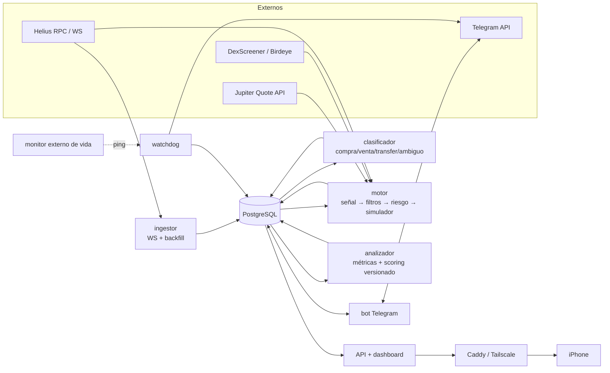

# Fase 1 — Investigación, viabilidad, arquitectura y presupuesto

- **Estado:** versión 2, actualizada con tus respuestas (apartado 10). Pendiente de tu «adelante» para empezar la Fase 2. No se ha escrito código de producción.
- **Fecha de la investigación:** 18 de octubre de 2026.
- **Alcance:** laboratorio de copy-trading **solo en simulación** sobre memecoins de Solana. Sin claves privadas, sin firma de transacciones y sin envío de órdenes. El **modo con dinero real** queda como Fase 9 opcional: solo se construirá si la simulación cumple los criterios del apartado 12 y tú lo apruebas expresamente.

---

## 0. Resumen ejecutivo

1. **El seguimiento on-chain de wallets públicas es viable**, pero hay que deducir la autoría de cada operación a partir de los cambios de balance. **No se puede deducir de quién firma la transacción.** En FOMO esto es crítico: según la documentación de Bitquery, **todas las operaciones de FOMO las firma y paga una única wallet de la propia FOMO** (un *relayer*), no la del trader. Lo verificaré on-chain en la Fase 2 antes de depender de ello.
2. **FOMO no publica una API oficial.** Los servicios que dicen ofrecer una «FOMO API» (fomoapi.io, fomoapi.family, getfomoapi.fun) son de terceros, no oficiales y no explican de dónde sacan los datos. Propongo **no depender de ellos**. La alternativa legítima es leer directamente de la cadena las transacciones que firma el relayer de FOMO.
3. **La simulación en vivo (*forward test*) puede ser muy realista**: cuando el sistema «ejecutaría», pide una cotización real a Jupiter para su propio tamaño de orden y, tras la latencia simulada, vuelve a cotizar. En cambio, **el backtest histórico será de menor fidelidad**, porque no hay precios ejecutables históricos fiables por segundo para memecoins. La evidencia principal será la Fase 8 (≥ 2 semanas en vivo).
4. **Los costes fijos son el gran problema económico.** Una configuración robusta cuesta del orden de **80–180 $/mes**, más que todo el capital virtual (100 $). Con dinero real y 100 $, la estrategia tendría que ganar >50 % al mes solo para pagar los datos. El sistema medirá la rentabilidad neta **también después de los costes fijos**.
5. **Hipótesis de partida, que debe medirse y no darse por buena:** copiar con retraso a traders de memecoins seguidos por miles de usuarios de una app social probablemente **no es rentable después de costes**. Nuestras compras llegan cuando el precio ya ha subido por el propio trader y por sus seguidores, y el trader puede estar usando a los seguidores como liquidez de salida. El sistema está diseñado para medir ese «coste de llegar tarde» trade a trade.

---

## 1. Método y límites de esta investigación

| Elemento | Resultado |
|---|---|
| Repositorio | Vacío salvo `README.md` (1 commit inicial). |
| Herramientas del entorno de desarrollo | Python 3.13, Node 22, Docker 29, PostgreSQL 16, `uv`. |
| Acceso de red desde este entorno | **Bloqueado** por la política de red del entorno para `helius.dev`, `mainnet.helius-rpc.com`, `api.mainnet-beta.solana.com`, `docs.birdeye.so`, `public-api.birdeye.so`, `lite-api.jup.ag`, `api.dexscreener.com`, `pro-api.solscan.io`, `api.geckoterminal.com`, `api.rugcheck.xyz` y `fomoapi.io`. Solo GitHub es accesible. |
| Consecuencia | La verificación es **documental**: se ha hecho con un buscador que resume las páginas oficiales. **No se ha hecho ninguna llamada real a ninguna API** ni se ha inspeccionado ninguna transacción on-chain. |

Niveles de verificación usados en este documento:

- **V0**: afirmación de terceros o no verificada.
- **V1**: documentación oficial del proveedor consultada (indirectamente, vía buscador).
- **V2**: probado con una llamada real.
- **V3**: probado y medido durante ≥ 24 h.

**Ninguna fuente está todavía en V2 o V3.** Pasarlas a V2 es el primer entregable de la Fase 2.

Para la Fase 2 necesito una de estas dos cosas: que habilites en el entorno de desarrollo los dominios anteriores, más `api.jup.ag`, `api.helius.xyz` y `api.telegram.org`, o que las pruebas en vivo se ejecuten directamente en el servidor. Las pruebas unitarias funcionarán siempre con *fixtures* grabadas.

---

## 2. Hallazgos sobre FOMO (fomo.family)

| Hallazgo | Fuente | Nivel |
|---|---|---|
| FOMO no publica API pública (comprobado por Bitquery el 29-sep-2026). Yo tampoco he encontrado documentación oficial. | Bitquery docs | V0 (tercero no afiliado) |
| Cada usuario tiene una wallet autocustodiada embebida (Privy), con una dirección Solana real visible en exploradores. | Blog de Privy | V1 |
| Las operaciones de FOMO en Solana las firma **y paga** una única wallet de FOMO. Bitquery da la dirección `AgmLJBMDCqWynYnQiPCuj9ewsNNsBJXyzoUhD9LJzN51`. Por eso `Signer` y `FeePayer` **nunca** son la wallet del usuario. | Bitquery docs | V0 — **verificar on-chain** |
| La mayoría de operaciones pasa por el agregador DFlow, y la wallet del usuario aparece como *owner* en esa instrucción. En las filas a nivel de pool puede aparecer una cuenta de token temporal. | Bitquery docs | V0 — **verificar** |
| En una hora de muestra, el relayer firmó unas 33.600 transacciones, de las que unas 26.000 contenían un swap. | Bitquery docs | V0 |
| FOMO patrocina el gas («gasless») y cobra comisión por swap. Opera también en EVM y en perpetuos vía Hyperliquid. | Prensa / reseñas | V0 |
| fomoapi.io se describe como API **independiente y no oficial**. Hay al menos tres dominios con productos parecidos (fomoapi.io, fomoapi.family, getfomoapi.fun) y ninguno documenta de dónde obtiene los datos. | Sus propias webs | V0 |

> **Actualización (Fase 2, 18-oct-2026):** verificado on-chain con transacciones reales. El relayer firma y paga el 100 % de la muestra, y **el trader aparece como segundo firmante**, así que se puede identificar sin ambigüedad. Las compraventas se pagan y cobran en USDC. Detalles en [`docs/informes/fase-2.md`](informes/fase-2.md).

**Consecuencias de diseño**

- El monitor atribuye cada operación por el **cambio neto de balances de las cuentas de token cuyo *owner* es la wallet seguida**, nunca por el firmante.
- El **PnL que muestra FOMO no es comparable** con lo que nosotros podemos copiar: puede incluir otras cadenas y perpetuos, y FOMO paga el gas del usuario, cosa que nosotros no tendríamos.
- **Descubrimiento legítimo de traders de FOMO:** filtrar on-chain las transacciones firmadas por el relayer y calcular nuestras propias métricas por wallet. No hace falta ni API privada ni *scraping*. Coste estimado: suscribirse a todo el tráfico del relayer (~9 tx/s) podría consumir **2–5 M créditos/mes** de Helius, según el tamaño real de cada transacción. Hay que medirlo; en el plan gratuito no cabe.
- Las «FOMO APIs» de terceros quedan **excluidas como fuente de señales**. Como mucho podrían servir de pista de descubrimiento, y solo si revisas sus condiciones y aceptas el riesgo legal y de fiabilidad.
- **Riesgo estructural:** FOMO es en sí mismo un motor de copy-trading con miles de usuarios. Cuando nosotros detectamos la compra, los seguidores de FOMO ya pueden haber movido el precio.

---

## 3. Matriz de fuentes de datos

| Fuente | Tipo | Qué aportaría | Precio / límites documentados | Nivel | Papel propuesto |
|---|---|---|---|---|---|
| **Helius** | Proveedor RPC comercial | WebSocket de transacciones, `getTransaction`, historial por dirección, webhooks | Free 0 $: 1 M créditos/mes, 10 rps. Developer 49 $: 10 M créditos, 50 rps, *Enhanced WebSockets* (`transactionSubscribe`) desde el 7-abr-2026. Business 499 $: LaserStream gRPC en mainnet. Los WebSockets se cobran a 2 créditos por cada 0,1 MB desde el 12-abr-2026. `getTransactionsForAddress`: 10 créditos por cada 100 transacciones. Conflicto entre páginas: 100 o 1.000 suscripciones por conexión. | V1 | **Fuente principal on-chain** |
| **Jupiter API** | Agregador DEX oficial | Cotización ejecutable para *nuestro* tamaño (precio, impacto, ruta) | Sin clave: 0,5 rps. Free con clave: 1 rps. Developer: 10 rps. Launch: 50 rps. Pro: 150 rps. Precios de los planes de pago **no confirmados**; la retirada de `lite-api` está aplazada sin fecha. | V1 | **Precio de ejecución simulado** |
| **DexScreener** | Agregador público | Pares, liquidez, antigüedad del pool | Gratis. Límites de 60/300 peticiones/min **solo según fuentes de terceros**; condiciones de uso no verificadas. | V0 | Liquidez y metadatos (secundaria) |
| **Birdeye** | Proveedor de datos comercial | OHLCV, seguridad de tokens, PnL de wallets | Standard gratis: 30.000 CU, 1 rps, solo 3 endpoints (insuficiente). Starter 99 $ (3 M CU). Premium 199 $ (10 M CU). Los endpoints de wallet tienen un límite propio más bajo. | V1 | Opcional para backtest (OHLCV) |
| **Solscan Pro API** | Explorador comercial | Actividades DeFi y transferencias por cuenta | Lite 49 $: 20 M CU, 1.000 peticiones/min, sin endpoints *multi*. Historial de actividades DeFi: 6 meses. | V1 | Alternativa para historial y *backfill* |
| **Solana Tracker** | Proveedor de datos comercial | PnL, *leaderboard*, traders por token | Free: 2.500 peticiones/mes. Advanced ~50 €/mes (200.000 peticiones). El PnL lo calculan ellos. | V0–V1 | Solo contraste, nunca como verdad |
| **Bitquery** | Proveedor de datos comercial | Consultas GraphQL y *streams* de DEX trades; guía de FOMO | Free: **solo uso personal**, 10 peticiones/min, 10.000 puntos de prueba. Comercial: bajo presupuesto. | V1 | Validación cruzada puntual |
| **RugCheck** | Tercero | Informe de riesgo de tokens | Autenticación y precio no verificados. | V0 | Opcional; **nunca suficiente por sí solo** |
| **Datos on-chain directos** (`getAccountInfo` del mint) | Cadena | Autoridades de mint y freeze, extensiones Token-2022 (*transfer hook*, *transfer fee*, *permanent delegate*), *supply* | Cuesta créditos RPC | — | **Verdad base para los filtros** |
| **Telegram Bot API** | Oficial | Control y alertas | Gratis | — | Mando a distancia |

**Regla:** las cifras de PnL o *win rate* de terceros (Birdeye, Solana Tracker, FOMO) solo se usan como **contraste**. Las métricas de verdad se calculan a partir de transacciones on-chain propias.

---

## 4. Viabilidad

### 4.1 Técnicamente viable

- Seguimiento 24/7 de wallets añadidas a mano, con reconexión y recuperación de huecos (`getSignaturesForAddress` desde el último *checkpoint*).
- Clasificación de cada evento como compra, venta, transferencia o ambiguo, con un nivel de confianza calculado a partir de `pre/postTokenBalances` y de los lamports por *owner*.
- Simulación en vivo con precio ejecutable real (cotización de Jupiter) tras la latencia simulada, con fallos por slippage, ejecuciones parciales y tokens sin ruta de venta.
- Métricas de trader (PnL realizado a 7 y 30 días, *win rate*, *holding*, drawdown, concentración) a partir del historial on-chain.
- Detección con confianza de compras en el bloque de creación (comparando el slot de la compra con el del mint o el pool) y de *holdings* demasiado cortos para copiarlos.
- Dashboard, Telegram, Docker, PostgreSQL, *healthchecks*, copias de seguridad y recuperación: todo tecnología estándar.

### 4.2 Viable solo de forma parcial o con baja fidelidad

- **Backtest de la copia con retraso.** Hace falta saber qué precio había X segundos después de la operación del trader, para nuestro tamaño. La estimación usará los swaps on-chain posteriores en el mismo pool, o el OHLCV de 1 minuto si se contrata. Se marcará siempre como **estimado** y nunca se mezclará con resultados en vivo.
- **Vínculos con wallets de desarrolladores.** Solo con heurísticas (financiación común, transferencias directas, compras en el bloque inicial). La confianza será baja o media, y nunca se etiquetará a nadie como *insider*.
- **Sesgo de supervivencia.** Los tokens muertos desaparecen de muchas APIs. Se reduce guardando nosotros todo lo que observamos desde el primer día.

### 4.3 No viable o desaconsejado

- Copiar «todas las operaciones de cualquier trader de FOMO» sin verificarlo. No es posible garantizarlo.
- Usar el PnL de FOMO como métrica de nuestra estrategia.
- Automatizar la app de FOMO o usar sus endpoints privados (excluido por tus normas).
- Igualar la latencia de los bots profesionales (<50 ms, mismo bloque) con un presupuesto de 100 $ y un VPS. Nuestra latencia se **medirá**, no se supondrá.

---

## 5. Arquitectura recomendada

### 5.1 Lenguaje y tecnologías

**Python 3.12+** (asyncio), por estas razones:

- Ecosistema cuantitativo (numpy, pandas, scipy) para el backtest, el *bootstrap* y los intervalos de confianza.
- FastAPI y SQLAlchemy 2 + Alembic son maduros.
- `solders` permite validar direcciones y decodificar transacciones.
- Es más fácil de leer para alguien que no es desarrollador profesional.

TypeScript tiene SDKs de Solana más completos para **firmar y enviar** transacciones, pero en la fase de simulación no se firma nada. Si algún día se aprueba el modo real, el firmante sería un servicio aparte y mínimo.

| Pieza | Elección | Motivo |
|---|---|---|
| Persistencia | PostgreSQL 16 (SQLite solo en tests rápidos) | Transacciones ACID, restricciones `UNIQUE`/`CHECK` para la idempotencia y los saldos no negativos |
| Cola | **La propia PostgreSQL** (`FOR UPDATE SKIP LOCKED` + patrón *outbox*) | Evita añadir Redis o RabbitMQ: un componente menos que pueda fallar o desincronizarse |
| HTTP | `httpx` con timeouts, reintentos con *backoff* y *token bucket* por proveedor | Límites de peticiones y presupuesto de créditos |
| Configuración | `pydantic-settings` con validación y topes duros en código | Ningún parámetro puede superar los límites de seguridad |
| Logs | `structlog` en JSON, con filtro de secretos | Logs estructurados sin tokens |
| Interfaz gráfica | **React + TypeScript** (Vite) con gráficas **TradingView Lightweight Charts**, compilada a ficheros estáticos que sirve FastAPI. Instalable como app (PWA) en la pantalla de inicio del iPhone y usable desde cualquier navegador. | Pediste una interfaz gráfica completa. Una app nativa de iOS exigiría un Mac y la cuota de Apple Developer, y no aporta nada para este uso. |
| Telegram | `python-telegram-bot` | Mantenido; *polling* sin exponer puertos |
| Acceso privado | **Tailscale** (plan Personal gratuito). El dashboard solo es accesible desde tus dispositivos; no hace falta dominio. | El panel de control no queda expuesto a internet |
| Tests | pytest, pytest-asyncio, respx (*mocks* HTTP), *fixtures* JSON de transacciones reales | Reproducible |

### 5.2 Componentes (una sola imagen Docker, varios procesos)

| Servicio | Responsabilidad | Si falla… |
|---|---|---|
| `ingestor` | Suscripción WS a las wallets seguidas. Al (re)conectar, *backfill* desde el *checkpoint* por wallet. Guarda la transacción en bruto con `signature` única, slot, `block_time`, `detected_at` y fuente. | El motor pasa a **solo lectura** si los datos dejan de estar al día. |
| `clasificador` | Convierte la transacción en `wallet_events` con su tipo y confianza. Distingue venta de transferencia: en una transferencia no hay contrapartida en SOL/USDC y el token cambia de *owner*. | Los eventos quedan en cola; no se genera ninguna señal. |
| `motor` | Pipeline secuencial: señal → filtros de seguridad → riesgo → orden simulada → *fill*. Cada decisión se guarda con sus motivos. | No se abren posiciones. Las salidas se reintentan. |
| `analizador` | Calcula métricas y puntuaciones de forma periódica. Guarda cada *snapshot* con su `as_of` y `params_hash`, para no usar información del futuro. | Se usan las últimas puntuaciones válidas; si son antiguas, se penalizan. |
| `api` | Dashboard y endpoints privados. | Telegram sigue funcionando. |
| `bot` | Comandos y alertas. `/pausar` escribe **directamente** en `control_state`, sin pasar por el motor ni por los proveedores. | El dashboard sigue funcionando. |
| `watchdog` | Comprueba los *heartbeats* de cada servicio, la frescura de los datos y el gasto de créditos, y envía alertas. | Un **monitor externo** (por ejemplo healthchecks.io) avisa si muere el servidor entero. |
| `backup` | `pg_dump` cifrado y copia fuera del servidor, con prueba de restauración periódica. | Alerta. |

### 5.3 Estados del sistema

`RECOVERING` → `RUNNING` ⇄ `PAUSED` (manual), `HALTED_RISK` (límite de riesgo alcanzado), `READ_ONLY` (datos poco fiables) → `STOPPED`

- En cualquier estado distinto de `RUNNING` **no se abren posiciones**. La comprobación se hace dentro de la misma transacción SQL que abriría la posición, así que es atómica.
- Salir de `HALTED_RISK` requiere una acción manual (`/reanudar`) después de validar el estado. El sistema **nunca sube el riesgo** para recuperar pérdidas.

### 5.4 Recuperación tras una caída

1. Al arrancar, el estado es `RECOVERING` y no se permiten entradas.
2. Para cada wallet, se recuperan las firmas desde el último *checkpoint* y se procesan en orden.
3. Los eventos recuperados **nunca generan entradas**, porque la oportunidad ya pasó. **Sí** pueden generar salidas: si el trader vendió mientras estábamos caídos, se simula la venta al precio actual y se marca como tardía.
4. Se reconcilian las posiciones virtuales con el *ledger* y se comprueba la frescura de los datos. Solo entonces el sistema pasa a `RUNNING`.

### 5.5 Idempotencia y consistencia

- `raw_transactions.signature` es `UNIQUE`. `wallet_events` es `UNIQUE (signature, wallet, mint, ix_index)`.
- Cada orden simulada lleva una `idempotency_key = hash(signal_id, decision_version)` única.
- *Ledger* de doble entrada. Restricciones `CHECK`: el efectivo y la cantidad de una posición nunca pueden ser negativos, y no se puede vender más de lo que se tiene.
- El tope de capital (100 $) es una **constante en el código**. La configuración solo puede bajarlo. Cambiar de escenario exige una acción explícita y queda registrado.

### 5.6 Garantías de «solo simulación»

- Sin dependencias ni código de firma. No existe ningún método `sendTransaction`.
- Un test de CI falla si aparecen en `src/` símbolos prohibidos (`Keypair`, `sendTransaction`, `private_key`, `seed`, etc.).
- El validador de configuración rechaza cualquier `MODE` distinto de `simulation`.
- Telegram no tiene comandos de retirada, transferencia ni exportación de claves.

**Preparado para un posible modo real, sin implementarlo:** el motor de decisión entrega cada orden a un **ejecutor** a través de una interfaz única. Ahora solo existe `SimExecutor`. Si algún día se aprueba la Fase 9, se añadiría un `RealExecutor` sin tocar la lógica de decisión, de modo que la simulación mide exactamente lo que haría el bot real.

### 5.7 Modelo de datos (tablas principales)

| Grupo | Tablas |
|---|---|
| Wallets y datos | `tracked_wallets`, `ingest_checkpoints`, `raw_transactions`, `wallet_events` |
| Tokens y mercado | `tokens`, `token_safety_checks`, `market_quotes` (con `observed_at`) |
| Análisis de traders | `wallet_metric_snapshots`, `wallet_scores` (versionadas) |
| Decisiones | `signals`, `decisions` (motivos en JSON) |
| Simulación | `sim_orders`, `sim_fills`, `positions`, `ledger_entries`, `portfolio_snapshots` |
| Operación | `control_state`, `risk_events`, `service_heartbeats`, `provider_usage`, `audit_log` |

---

## 6. Modelo de simulación y medición

### 6.1 Ejecución simulada de una compra

1. **t0**: momento del bloque de la operación del trader. Su precio de ejecución (*fill*) se calcula a partir de los deltas de balance.
2. **t1**: momento de detección (`detected_at`). Se mide la latencia de detección, t1 − t0.
3. **t2**: fin de los filtros y del control de riesgo. Se pide una cotización a Jupiter para **nuestro** tamaño de orden.
4. **t3** = t2 + latencia simulada de envío y confirmación (configurable). El sistema **espera de verdad** ese tiempo y vuelve a cotizar:
   - si la nueva cotización es peor que la tolerancia de slippage, la orden **falla** como fallaría on-chain, y se cobra igualmente la *priority fee*;
   - si no falla, el *fill* es la cotización en t3 menos un recorte configurable por MEV/*sandwich* (marcado como supuesto).
5. Se registran todos los costes: comisión base, *priority fee* o propina Jito supuesta, renta de la cuenta de token (ATA) y comisión de ruta.

Las ventas siguen el mismo proceso. Si no hay ruta o el impacto supera el máximo permitido, la venta es parcial o no se ejecuta. Una posición sin ruta de venta se valora en **0** en el patrimonio neto (criterio conservador) mientras se reintenta.

### 6.2 Dos libros paralelos

- **Cartera restringida (100 $):** lo que habría pasado de verdad, con todos los límites de riesgo.
- **Libro de señales:** cada señal válida se simula con un tamaño nominal fijo y sin restricción de capital. Sirve para tener **suficientes observaciones** con las que medir si hay ventaja (*edge*). Con 100 $ y 5 posiciones simultáneas, dos semanas rara vez dan una muestra útil.

### 6.3 Comparativas obligatorias

- **Copia instantánea teórica** al precio del trader. Es una cota superior inalcanzable.
- **Copia con el retraso realista** medido.
- **No operar.**
- **Mantener SOL** como referencia pasiva.

La diferencia entre la copia teórica y la realista es el **coste de llegar tarde**, y se reporta por trader y por token.

### 6.4 Estadística

- PnL neto, drawdown, *profit factor*, *win rate*, coste medio por operación.
- Sharpe y Sortino solo con observaciones suficientes.
- Intervalos de confianza por *bootstrap* y probabilidad de que la media neta sea > 0.
- Aviso de «muestra insuficiente» con menos de 30 operaciones cerradas, y aviso reforzado por debajo de 100.

---

## 7. Costes mensuales estimados

Las cifras salen de documentación consultada indirectamente (V1), y varias fuentes se contradicen. Se confirmarán al contratar.

### 7.1 Mínimo (investigación con 10–30 wallets, sin descubrimiento masivo)

| Concepto | Opción | Coste/mes |
|---|---|---|
| Servidor | Hetzner gama más barata (CX23 ~5,49 € / CAX11 ~5,99 € tras la subida de abril de 2026, con **disponibilidad limitada desde junio**) o DigitalOcean 2 GB (12–18 $) | 6–18 $ |
| Copias de seguridad externas | Almacenamiento de objetos o *Storage Box* | 1–4 $ |
| Helius | Free (1 M créditos; sin *Enhanced WebSockets*; los WebSockets también consumen créditos) | 0 $ |
| Jupiter | Free con clave (1 rps) | 0 $ |
| DexScreener, Telegram, monitor externo | Gratis | 0 $ |
| **Total** | | **≈ 7–25 $/mes** |

Limitaciones de este escenario:

- 1 rps de cotizaciones obliga a limitar el número de posiciones vigiladas.
- 1 M de créditos puede quedarse corto si las wallets son muy activas.
- No incluye el descubrimiento de traders vía relayer de FOMO.

### 7.2 Robusto

| Concepto | Opción | Coste/mes |
|---|---|---|
| Servidor 4 GB + copias de seguridad | DigitalOcean 24 $ + ~20 % de backups, o el equivalente en Hetzner | 25–30 $ |
| Helius Developer | 10 M créditos, 50 rps, *Enhanced WebSockets* | 49 $ |
| Jupiter Developer (10 rps) | Precio **por confirmar** | ? |
| Historial para el backtest | Solscan Lite 49 $ **o** Birdeye Starter 99 $ (solo los meses de backtest) | 0–99 $ |
| **Total** | | **≈ 75–180 $/mes + Jupiter** |

### 7.3 Presupuesto acordado: 20–50 $/mes

| Concepto | Opción | Coste/mes | Nota |
|---|---|---|---|
| Servidor | IONOS VPS con 4 GB de RAM (centro de datos en la UE) | ~4–10 € | Precios de entrada según reseñas; **la renovación tras la promoción es más cara**. Hay que confirmar precio, renovación y permanencia al contratar. |
| Helius | Free al principio; **Developer** cuando empiece el descubrimiento vía relayer | 0 $ → 24,50 $ o 49 $ | La página de precios de Helius dice 24,50 $ y su documentación 49 $. Hay que confirmarlo. `getTransactionsForAddress` y las *Enhanced WebSockets* requieren Developer. |
| Jupiter | Free con clave (1 rps) | 0 $ | Developer cuesta 25 $/mes (10 rps). No cabe en el presupuesto junto con Helius Developer; diseñaremos para 1 rps. |
| Tailscale, Telegram, monitor externo | Planes gratuitos | 0 $ | |
| Copias de seguridad | Almacenamiento externo pequeño | 0–2 $ | |
| **Total** | | **≈ 5–12 $** al principio; **≈ 30–60 $** con Helius Developer | |

Si Helius Developer cuesta realmente 49 $, nos pasaríamos un poco del techo de 50 $. En ese caso: (a) Developer solo durante los meses de descubrimiento, o (b) descubrimiento por muestreo con el plan Free. **Nunca se contrata nada sin tu aprobación.**

### 7.4 Control de gasto

- Un módulo `provider_usage` lleva la cuenta de créditos y peticiones por proveedor.
- Al llegar al 80 % del presupuesto mensual, envía una alerta. Al llegar al 100 %, el sistema se degrada: se para primero el descubrimiento y el *backfill* histórico, y se mantiene el seguimiento de las posiciones abiertas.
- **Nunca** sube de plan automáticamente.

---

## 8. Riesgos técnicos y limitaciones de los 100 $

### 8.1 Riesgos técnicos principales

1. **Atribución errónea**: relayers, firmante único de FOMO, transferencias entre wallets del mismo trader, swaps con varios saltos, wSOL, Token-2022. *Mitigación:* confianza por evento, y solo se usan los eventos de confianza alta.
2. **Latencia**: memecoins que se mueven en segundos, bots que operan en el mismo bloque y seguidores de FOMO por delante de nosotros. *Mitigación:* medirla y simularla con cotización diferida.
3. **Proveedores inestables**: Helius y Jupiter han cambiado sus precios y planes en 2026, y las «FOMO APIs» son de terceros. *Mitigación:* adaptadores intercambiables y presupuesto de uso.
4. **Ventas imposibles de replicar**: *rug pulls*, liquidez que desaparece, *honeypots*, *transfer hooks*/*fees* de Token-2022, *freeze*.
5. **Historiales manipulados**: wallets que fabrican resultados, bots de atención, *wash trading*, traders que usan a sus seguidores como liquidez de salida.
6. **Sobreajuste** del *scoring* con pocas operaciones.
7. **Seguridad**: un dashboard expuesto a internet. *Mitigación:* Tailscale, o como mínimo login + 2FA + límite de intentos.

### 8.2 Limitaciones de un capital de 100 $

Cálculo ilustrativo con SOL ≈ 100 $. El sistema usará el precio real en cada momento.

| Coste | Magnitud | Peso en una posición de 10 $ |
|---|---|---|
| Renta de la cuenta de token (ATA) al comprar un token nuevo | 0,00148844 SOL ≈ 0,15 $ (recuperable al cerrar la cuenta). Medido on-chain en la Fase 2 con `getMinimumBalanceForRentExemption(165)`; la cifra antigua, 0,00203928 SOL, ya no es válida. | ~1,5 % inmovilizado |
| Comisión base | 0,000005 SOL por firma | Despreciable |
| *Priority fee* / propina Jito competitiva | 0,0001–0,001+ SOL por transacción | 0,1–1 % por lado |
| Comisión de pool | ~1 % en la *bonding curve* de pump.fun; ~0,25–0,3 % en PumpSwap, más una comisión de creador variable (fuentes secundarias) | 0,5–2 % ida y vuelta |
| Slippage y retraso | Depende del token. Suele ser el coste dominante en memecoins (varios %). | **Se medirá** |

Otras consecuencias de un capital tan pequeño:

- Con 100 $, una reserva del 20 % y posiciones de 10–20 $, caben 4–8 posiciones como máximo. **Hay muy poca diversificación y mucha varianza.**
- En dos semanas probablemente no habrá suficientes operaciones cerradas para extraer conclusiones estadísticas. De ahí el libro de señales del apartado 6.2.
- Los costes fijos (7–180 $/mes) superan el capital. Sin más capital o con costes casi nulos, operar en real sería económicamente irracional aunque la estrategia tuviera una ventaja pequeña.

---

## 9. Plan de implementación por fases

### Reglas de cierre de fase (válidas para todas)

Una fase **no** está terminada porque el código compile o porque una simulación funcione. Para cerrarla hacen falta tres cosas:

1. Un informe en `docs/informes/fase-N.md` con:
   - los comandos ejecutados, el *hash* del commit y la salida real de los tests;
   - las pruebas de integración contra la API real (grabadas como *fixtures*), más un *smoke test* en vivo;
   - las pruebas de recuperación que procedan;
   - la lista de problemas abiertos.
2. Ningún fallo crítico abierto.
3. Tu aprobación explícita.

### Fases

| Fase | Contenido | Criterios de aceptación (con evidencia) |
|---|---|---|
| **1** | Este documento | Tu aprobación y respuestas a las preguntas del apartado 10 |
| **2** | **Comprobación inicial (*spike*):** atribución de ≥ 20 transacciones reales de FOMO (incluido el relayer), latencia de detección p50/p95 en el plan Free y consumo de créditos en 24 h. Después: clientes de proveedores (timeouts, reintentos, límites, presupuesto), ingestor WS + *backfill*, clasificador, *checkpoints*, migraciones. | Precisión ≥ 95 % de los eventos de confianza alta sobre una muestra etiquetada a mano (si no se alcanza, **paro y te informo**). Tests de duplicados, reconexión, recuperación de huecos y clasificación (compra, venta, transferencia, varios saltos, relayer, Token-2022). |
| **3** | Analizador de traders: métricas, detección de sesgos con confianza, *scoring* configurable y explicado, *snapshots* versionados | Tests de métricas con *fixtures* calculadas a mano. Test de que no se usa información posterior al `as_of`. |
| **4** | Filtros de seguridad, motor de simulación, gestión de riesgo, los dos libros, idempotencia | Tests de PnL, costes, slippage, tamaño de posición, stops, drawdown, pausa automática, rechazo por datos insuficientes o incoherentes, saldos no negativos, sin ventas superiores a la posición. *Kill* a mitad de una orden sin duplicados al reiniciar. |
| **5** | Backtester: división cronológica, latencia y costes, comparativas, *bootstrap*, informes reproducibles | Mismo informe a partir de la misma semilla y los mismos datos. Avisos de muestra insuficiente. Limitaciones documentadas. |
| **6** | Dashboard PWA y bot de Telegram | Tests de autenticación (sesión, CSRF, límite de intentos) y de rechazo de usuarios de Telegram no autorizados. `/pausar` funciona con los proveedores caídos. |
| **7** | Docker Compose en la nube, *healthchecks*, logs con rotación, copias de seguridad **con prueba de restauración**, monitor externo, gestión de secretos, control de gasto | Simulacro de caos: `kill -9` de cada servicio, reinicio de la máquina, corte de red y reinicio de PostgreSQL, todo con recuperación verificada. |
| **8** | ≥ 14 días de simulación continua (se recomiendan 4 semanas) e informe final | El informe aplica los criterios del apartado 12 y permite decidir si seguir investigando. **No** cambia nunca a modo real. |
| **9** *(opcional)* | Modo real, solo si se cumplen **todos** los criterios del apartado 12 y lo apruebas expresamente | Ver el apartado 12.2. |

---

## 10. Respuestas y decisiones (18-oct-2026)

| # | Tema | Tu respuesta | Decisión |
|---|---|---|---|
| 1 | Wallets de traders | No tienes ninguna | El descubrimiento pasa a ser una pieza central: se hará on-chain a partir del relayer de FOMO, y calcularemos nuestro propio ranking. También podrás añadir wallets a mano desde la interfaz. |
| 2 | Presupuesto | 20–50 $/mes | Apartado 7.3. El control de gasto tendrá un tope de 50 $/mes. |
| 3 | Descubrimiento vía relayer | Sí | Fase 2. Primero se verifica on-chain con el RPC público de Solana (gratis). Después, Helius Developer con tu aprobación. |
| 4 | Dashboard y dominio | No tienes nada | Tailscale (gratis, sin dominio). |
| 5 | Hosting | IONOS | Aceptado: VPS de 4 GB en la UE. Hay que confirmar el precio de renovación y la permanencia. |
| 6 | Alcance | Solo conoces FOMO | Solo **compraventa directa de tokens en Solana**. Se excluyen las otras redes que también ofrece FOMO (Base, BNB…) y los perpetuos (apuestas con apalancamiento vía Hyperliquid). Según la prensa del sector, casi todos los ingresos por comisiones de FOMO vienen de swaps en Solana. |
| 7 | Límites de riesgo | De acuerdo | 10 $ por posición, 5 posiciones como máximo, 20 % de reserva, stop de pérdida diaria del 10 % y pausa automática con un drawdown del 25 %. Desde la interfaz solo se podrán **endurecer**, nunca relajar por encima de estos valores. |
| 8 | Lenguaje e interfaz | Python sí, pero con interfaz gráfica | Python en el servidor y una interfaz web en React/TypeScript (apartado 5.1). |
| 9 | Red del entorno de desarrollo | No lo sabes | Ver el apartado 11. |
| — | Petición nueva | Un modo de simulación que te sirva para decidir si meter dinero real | Apartado 12, más una pantalla «¿Es rentable?» en la interfaz. |

**Pantallas previstas de la interfaz gráfica**

- **Inicio:** semáforo «¿Es rentable?», saldo virtual, PnL neto, drawdown y estado del sistema.
- **Posiciones y operaciones:** abiertas e historial, con el motivo de cada compra, venta o rechazo.
- **Traders:** ranking con la puntuación explicada; añadir y quitar wallets.
- **Simulador «¿y si…?»:** vuelve a ejecutar los datos ya grabados con otros parámetros (tamaño de posición, latencia, stops). Muestra un aviso de sobreajuste, y **sus resultados no cuentan para el semáforo**.
- **Configuración:** solo dentro de los límites de seguridad.
- **Control:** pausar, reanudar y detener.
- **Alertas y rechazos.**
- **Costes:** gasto en proveedores frente al presupuesto.

---

## 11. Siguiente paso: acceso a datos reales desde el entorno de desarrollo

El entorno en la nube donde trabaja el asistente de programación bloquea las direcciones de los proveedores de datos. Por eso todavía no se ha podido comprobar ninguna transacción real. Para permitirlas:

1. En la barra de título de la sesión, abre el menú del entorno y pulsa **Edit**.
2. En **Network access**, añade en **Allowed domains**:
   - `api.mainnet-beta.solana.com`: basta para la primera verificación. Es gratis y no requiere cuenta.
   - `mainnet.helius-rpc.com`, `api.helius.xyz`, `api.jup.ag`, `lite-api.jup.ag`, `api.dexscreener.com` y `api.telegram.org`: se usarán más adelante.

   Deja marcada la casilla **Allow package managers**.
3. Guarda los cambios.

Guía oficial: <https://code.claude.com/docs/en/cloud-environments#network-access>

La alternativa es hacer la verificación directamente en el servidor IONOS. El inconveniente es que tendrías que pagar el servidor antes de saber si la detección de traders de FOMO funciona.

---

## 12. Criterios para decidir si usar dinero real

Estos criterios se fijan **antes** de ver ningún resultado, para no cambiar las reglas a mitad del partido. La interfaz los mostrará como un semáforo:

- **Gris:** muestra insuficiente.
- **Rojo:** con muestra suficiente, algún criterio falla.
- **Amarillo:** prometedor, pero aún falta algún criterio.
- **Verde:** se cumplen todos.

### 12.1 Criterios (todos obligatorios)

| # | Criterio | Umbral |
|---|---|---|
| 1 | Duración | ≥ 28 días seguidos de simulación en vivo sin fallos críticos |
| 2 | Muestra | ≥ 100 operaciones cerradas en el libro de señales y ≥ 30 en la cartera de 100 $ |
| 3 | Ventaja neta | Rentabilidad media neta por operación > 0 después de todos los costes variables, con el límite inferior del intervalo de confianza del 95 % (*bootstrap*) también > 0 |
| 4 | Cartera de 100 $ | Beneficio neto positivo al final del periodo. Se muestra también descontando los costes fijos mensuales. |
| 5 | Riesgo | Drawdown máximo < 25 % y ninguna pausa automática por anomalía que quede sin explicar |
| 6 | Robustez | Sigue en positivo al quitar las 3 mejores operaciones y al quitar al mejor trader, y es positiva en las dos mitades del periodo |
| 7 | Calidad de datos y de operación | Precisión de atribución ≥ 95 %, disponibilidad ≥ 99 %, cero órdenes duplicadas y pruebas de recuperación superadas |

Un semáforo en verde **no garantiza beneficios futuros**: las memecoins pueden perder todo su valor en minutos y el mercado cambia.

**Comprobación económica:** con 100 $, ganar un 10 % al mes son 10 $, menos de lo que cuesta la infraestructura (~30–60 $/mes). El modo real solo tendría sentido económico si la rentabilidad neta cubre los costes fijos, o si para operar en real se reduce la infraestructura a planes gratuitos.

### 12.2 Fase 9: modo real (solo con todo en verde y tu aprobación expresa)

- **Wallet nueva** de Solana dedicada solo al bot. No sería tu wallet de FOMO. La recargas tú, con la cantidad que decidas y como máximo 100 $; se recomienda empezar con 20–30 $.
- El bot hace **sus propios swaps en Solana** a través de Jupiter. FOMO no interviene.
- El motor de decisión es el mismo; solo cambia el ejecutor. La simulación sigue funcionando en paralelo para comparar los *fills* reales con los simulados.
- **Protecciones:**
  - tope de capital fijado en el código;
  - nunca recarga fondos automáticamente, ni pide préstamos, ni usa apalancamiento;
  - cada orden se registra antes de enviarse y se comprueba su estado antes de reintentarla, así que no puede haber órdenes duplicadas;
  - límite de pérdida diaria y botón de parada en Telegram y en la interfaz;
  - la clave está cifrada y solo existe en el servidor, nunca en el repositorio;
  - el bot no puede retirar fondos: las retiradas las haces tú a mano desde tu propia wallet.
- Usa solo dinero que puedas permitirte perder por completo.

---

## 13. Fuentes consultadas

- Helius — precios y planes: <https://helius.dev/pricing>, <https://www.helius.dev/docs/billing/plans>, créditos: <https://docs.helius.xyz/docs/billing/credits.md>, WebSockets: <https://www.helius.dev/docs/faqs/websockets>, cambios de abril de 2026: <https://www.helius.dev/blog/laserstream-websockets>
- Jupiter — límites: <https://developers.jup.ag/docs/portal/rate-limits>, FAQ: <https://developers.jup.ag/docs/portal/faq>, aplazamiento de `lite-api`: <https://developers.jup.ag/changelog/2025-11>
- Birdeye — precios: <https://docs.birdeye.so/docs/pricing>, límites: <https://docs.birdeye.so/docs/rate-limiting>, acceso por paquete: <https://docs.birdeye.so/docs/data-accessibility-by-packages>
- Solscan — niveles: <https://docs.solscan.io/api-access/solscan-pro-api-levels-and-details>, FAQ: <https://docs.solscan.io/api-access/solscan-pro-api-faq>
- Bitquery — guía de FOMO: <https://docs.bitquery.io/docs/blockchain/Solana/fomo-api/>, precios: <https://bitquery.io/pricing>
- Solana Tracker — <https://www.solanatracker.io/data-api>, <https://docs.solanatracker.io/guides/wallet-tracking.md>
- FOMO / Privy — <https://privy.io/blog/turning-trading-into-a-social-experience-with-fomo>, <https://www.datawallet.com/crypto/fomo-app-explained>, <https://solanacompass.com/news/fomo-social-trading-app-hits-157m-weekly-revenue-all-time-high-on-solana>
- APIs de FOMO de terceros (no oficiales) — <https://fomoapi.io/>, <https://fomoapi.io/docs>, <https://fomoapi.family/>, <https://getfomoapi.fun/>
- DexScreener (límites según terceros) — <https://github.com/opensvm/dexscreener-mcp-server>
- pump.fun / PumpSwap (fuentes secundarias) — <https://madeonsol.com/blog/what-is-pumpswap>, <https://www.theblock.co/post/354038/pumpswap-revenue-tokens>
- Hosting — <https://findstack.com/resources/hetzner-price-increase-2026>, <https://wz-it.com/en/blog/hetzner-price-increase-june-2026-cpx-ccx-alternatives/>, <https://infratally.com/articles/digitalocean-droplet-pricing-guide-2026/>
- IONOS (reseñas, no es la web oficial) — <https://www.experte.com/server/ionos>, <https://es.hostadvice.com/hosting-company/ionos-reviews/pricing/>, <https://www.comparevps.com/hosting/ionos>
- Planes de Jupiter — <https://developers.jup.ag/docs/portal/plans>
- `getTransactionsForAddress` de Helius — <https://www.helius.dev/blog/introducing-gettransactionsforaddress>, <https://www.helius.dev/docs/es/billing/credits.md>
- Tailscale — <https://tailscale.com/pricing/>
- RPC público de Solana (no apto para producción) — <https://solana.com/docs/tools/production-readiness.md>
- Copy-trading y latencia — <https://prereview.org/reviews/22679925>, <https://rpcfast.com/blog/how-to-build-a-solana-copy-trading-bot>
